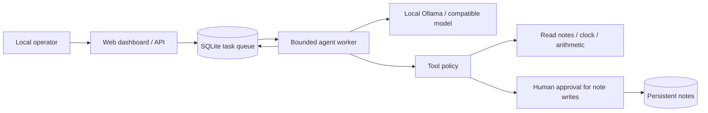

<div align="center">

# CHINGU (친구) by Falvorn AI

### Your AI friend that gets things done.

**Think together. Work smarter. Live better.**

A local-first, model-agnostic agent platform for personal and professional work.


[Public demo](https://falvorn-chingu.vercel.app) · [Quick start](#quick-start) · [Agent ecosystem](#agent-ecosystem) · [Capabilities](#capabilities) · [Security](SECURITY.md) · [Roadmap](docs/ROADMAP.md)

</div>

---

## Public demo

Explore the [interactive technical preview](https://falvorn-chingu.vercel.app). This static, noncommercial demo includes an animated 3D network and editable browser-local workflows, not live LLM inference. No API key or login is required. For real model execution, use the local quick start below.

## Overview

CHINGU (친구, Korean for friend) is an autonomous-agent platform designed to turn a goal into a bounded sequence of tool calls and a verifiable result. The initial release targets a single trusted operator, runs on their own machine, and does not require a paid cloud API.

## Agent ecosystem

| Agent | Purpose |
|:---|:---|
| **Personal CHINGU** | Everyday planning and assistance |
| **Work CHINGU** | Professional workflows and deliverables |
| **Dev CHINGU** | Software engineering guidance |
| **Research CHINGU** | Structured research and analysis |
| **Studio CHINGU** | Agent and workflow design |
| **Enterprise CHINGU** | Organizational workflows and policy analysis |

These are specialized instructions in a shared runtime, not separately trained models. Enterprise CHINGU is a role, not an enterprise-security certification.

## Architecture



## Capabilities

| Capability | Initial implementation |
|:---|:---|
| Specialist selection | Six agent profiles |
| Model inference | Real OpenAI-compatible chat completions, local Ollama default |
| Tool execution | Bounded tool loop, allowlisted tools, strict argument validation |
| Human approval | Note writes require explicit approval; never silently execute external actions |
| Persistent tasks | SQLite, results and tool events |
| Dashboard | Task submission, progress, approval, notes and results |
| Runtime | Python standard library; no paid service dependency |
| Browser, Gmail, MCP, recurring schedules | Roadmap, not implemented |
| Multi-tenant SaaS, enterprise SSO | Roadmap, not implemented |

## Quick start

Install Python 3.12+ and [Ollama](https://ollama.com/). Select a local model that supports reliable JSON instruction following, for example:

```bash
ollama pull qwen2.5:7b
git clone https://github.com/hossain0707/Falvorn-CHINGU.git
cd Falvorn-CHINGU
python -m chingu
```

Open http://127.0.0.1:8765. The server prints an access token on startup; paste it into the dashboard. Keep the token private. The model must be running locally. No model is downloaded automatically. Model size and RAM requirements depend on your choice.

Optional environment variables: `CHINGU_MODEL`, `CHINGU_MODEL_URL`, `CHINGU_MODEL_KEY`, `CHINGU_DB`, `CHINGU_TOKEN`, `CHINGU_PORT`. The default model endpoint is `http://127.0.0.1:11434/v1/chat/completions`. Changing to a hosted provider can incur charges and transmit task data to that provider.

## Quality and verification

```bash
python -m unittest discover -s tests -v
python -m compileall -q chingu tests
```

The test suite uses a deterministic fake model for reproducible tests; it does not claim to benchmark actual LLM quality. GitHub Actions runs these checks. Check the actual CI status before release.

## Free-resource strategy

Local Python, SQLite and Ollama have no required service subscription. Electricity, hardware, hosting and paid model APIs are not free. Model weights have their own licenses and usage conditions. Do not expose this local application directly to the public internet.

## Acknowledgments

Inspired by [Nod from n8n Labs](https://github.com/n8n-io/nod), which is Apache-2.0 licensed. CHINGU's initial runtime is independently implemented; it does not contain or embed Nod code, and is not affiliated with n8n. Any future upstream integration must preserve applicable licenses and notices.

## Project status

Engineering preview. Production-oriented controls are included, but public cloud deployment, independent security review, load testing and real-model validation remain release gates.

---

<div align="center">

**CHINGU by Falvorn AI** · Built for human–AI collaboration.

[GitHub](https://github.com/hossain0707/Falvorn-CHINGU) · [Falvorn AI](https://falvorn.ai)

</div>
